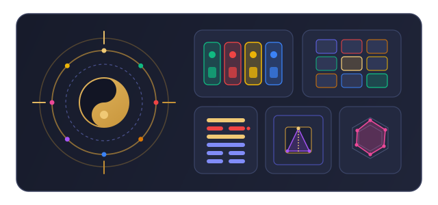

# 虚白 · 风水玄学罗盘

虚白（Restraint）是一个 **DeepSeek Harness（DSH）插件**，把四柱八字、奇门遁甲、梅花易数、紫微斗数和双人合盘放进同一个可交互工作台。你可以在侧栏手动排盘，也可以在聊天里让 DeepSeek 排盘，再点选柱位、宫位或卦象继续追问。



Restraint is a DeepSeek Harness plugin for interactive Chinese metaphysics charts. Cast Bazi, Qimen Dunjia, Meihua Yishu, Ziwei Doushu, and two-person compatibility charts locally, then ask DeepSeek to explain the active chart.

[English quick start](#english-quick-start)

## 安装

适用于 **DeepSeek Harness Desktop** 或 DSH 的 **Web** 界面，开发基线为 **DSH 0.2.2-rc.5**。

### Desktop 图形界面

1. 在左侧打开 **插件（Plugins）**，点击 **添加插件（Add plugin）**。
2. 粘贴以下 GitHub 仓库地址并确认安装。

   ```text
   https://github.com/MrSouthWall/dsh-restraint
   ```

3. 启用插件，按界面提示重启。打开会话后，点击左侧导航栏中与 **自动化任务** 同一组的 **虚白罗盘**，即可在主区域打开工作台。也可以从会话的右侧边栏打开。

从本地目录安装时，在 **添加插件** 中输入包含 `package.json` 和 `cordis.patch.yml` 的仓库根目录绝对路径。仓库已随附排盘依赖，可以直接启用。

### Web 命令行

在已安装 `dsh` 和 `pnpm` 的环境中执行以下命令。若 Web 界面已运行，安装后重启该 profile。

```sh
dsh plugin --profile web add github:MrSouthWall/dsh-restraint
dsh --profile web
```

## 快速上手

- **先看示例**。打开 **虚白罗盘 → 新手指南**，查阅白话术语和十二时辰对照表。每种盘面都可以通过 **新手演示** 加载样例。
- **复用生辰资料**。点顶部的 **生辰档案** 可新建、编辑和删除档案，也可以在排盘表单里点 **保存为档案**。四柱八字、紫微斗数和双人合盘都能用 **从档案填入**，合盘双方可各选一人。档案保存在当前浏览器或桌面客户端，可跨会话使用。
- **用对话排盘**。在聊天中发送「请用梅花易数，按数字 3 和 7 起卦，并说明本卦、互卦和变卦各代表什么」。DeepSeek 调用 `zhiming_chart` 后，结果会同步到工作台。
- **从盘面追问**。在工作台排盘后，点击 **D老师解读** 发起整盘解读。也可先选中柱位、宫位或卦象，再点击同名按钮追问。DeepSeek 通过 `zhiming_read` 读取当前会话的盘面。
- **用快捷指令**。在聊天输入框里试试以下命令。

```text
/zhiming help
/zhiming demo bazi
/zhiming bazi 1995-05-18 08:30 男
/zhiming qimen
/zhiming meihua 3 7
/zhiming demo ziwei
/zhiming demo hepan
```

## 排盘功能

| 模块 | 盘面与交互 |
| --- | --- |
| 四柱八字 | 支持公历和农历输入。输入北京时间与出生地经度，可换算当地真太阳时。查看干支、十神、藏干、明干支五行计数、大运和八宅命卦。 |
| 奇门遁甲 | 按拆补法排转盘时家奇门。查看洛书九宫、八门、九星、八神、值符值使、空亡、驿马与三吉门方位。 |
| 梅花易数 | 支持时间、数字、字数和程序随机起卦。查看五卦、体用关系及《周易》卦辞与大象。 |
| 紫微斗数 | 可交互十二宫星盘，展示主星、四化和大限。选中宫位即可查看三方四正。 |
| 双人合盘 | 结合八字与紫微斗数，提供恋爱婚姻、事业合伙、挚友亲子三种模式，并列查看六项盘面关系、五行分布和大运起止日期。 |

## 数据与用途

[查阅排盘数据来源与取法](docs/SOURCES.zh.md)，包括各模块的历法边界、古籍底本与依赖版本。

排盘由插件在 DSH Host 端计算。通过聊天提供出生信息或请求 DeepSeek 解读时，输入和工具返回的盘面摘要会进入当前 DSH 会话，摘要可能包含出生日期与所问事项。想先熟悉功能，可以使用内置演示数据。

插件不会给无关对话铺垫玄学语境：使用说明只在该会话已经排过盘，或用户自己提出排盘、起卦、合盘等请求后才进入模型上下文，新开的普通会话看不到任何玄学相关指令。工具本身始终可用，需要时 DeepSeek 会直接调用。

盘面及解读用于了解传统术数和民俗文化，重要决定请依据实际情况与相关专业意见。

## 开发

在仓库根目录使用锁定版本的依赖构建排盘库和 Web 客户端，然后运行测试。

```sh
pnpm install --frozen-lockfile
pnpm run build
pnpm test
```

- [index.js](index.js) 注册会话投影、`/zhiming` 指令和 DeepSeek 工具。
- [src/client](src/client) 提供侧栏工作台、对话卡片与可视化界面，构建产物为 `client.js`。
- [lib/engine](lib/engine) 包含五种排盘引擎。八字历法使用 [lunar-javascript](https://github.com/6tail/lunar-javascript)，紫微斗数使用 [iztro](https://github.com/SylarLong/iztro)。
- 更新排盘依赖时，请将重新生成的 `lib/vendor/` 和 `client.js` 一起提交，供 DSH 直接加载。
- [package.json](package.json) 和 [cordis.patch.yml](cordis.patch.yml) 声明 DSH bundle 的入口与加载方式。

遇到安装或排盘问题时，可在 GitHub 提交问题并附上 DSH 版本、插件版本和复现步骤。复现时可使用演示数据。[GitHub Issues](https://github.com/MrSouthWall/dsh-restraint/issues)

## English quick start

1. Open **Plugins → Add plugin** in DeepSeek Harness Desktop and enter `https://github.com/MrSouthWall/dsh-restraint`.
2. Enable the plugin, open a conversation, and click **Restraint studio** in the left navigation to open it in the main area. You can also open it from the conversation's right sidebar.
3. Try `/zhiming demo bazi` to open a sample chart. Use **D老师解读** to discuss the current chart with DeepSeek.
4. Open **Birth profiles** to manage saved people. Use **Fill from profile** in Four Pillars, Ziwei, or either side of a synastry chart.
